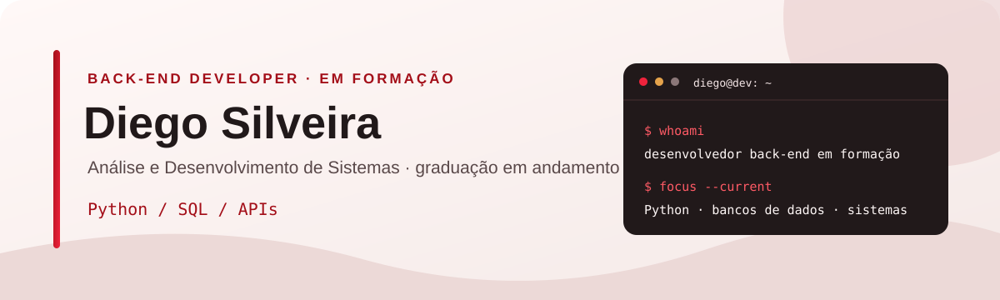
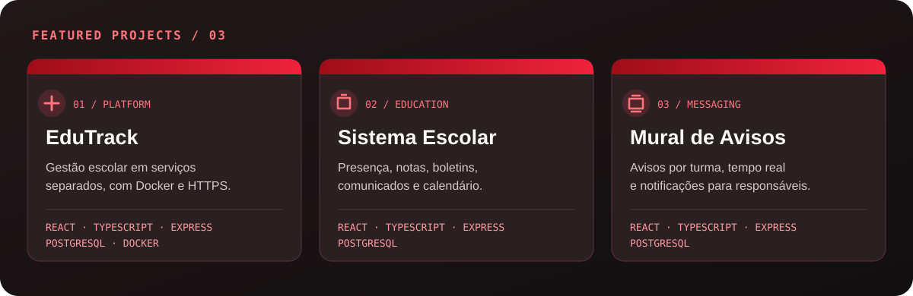

  <picture>
    <source media="(prefers-color-scheme: dark)" srcset="https://raw.githubusercontent.com/Kronosuchi17/kronosuchi17/main/assets/header-red-dark.svg">
    <source media="(prefers-color-scheme: light)" srcset="https://raw.githubusercontent.com/Kronosuchi17/kronosuchi17/main/assets/header-red-light.svg">
    
  </picture>

  <code>PYTHON · INTERMEDIÁRIO</code>
  &nbsp; <code>BANCO DE DADOS · INTERMEDIÁRIO</code>
  &nbsp; <a href="https://github.com/Kronosuchi17">GITHUB · KRONOSUCHI17</a>

---

## `$ whoami`

Sou **Diego Silveira**, graduando em **Análise e Desenvolvimento de Sistemas**. Estou direcionando minha carreira para **desenvolvimento back-end com Python e bancos de dados**.

Tenho conhecimento intermediário em Python e bancos de dados. Nos meus projetos web, também trabalho com APIs, persistência de dados e integração entre front-end e back-end.

## `$ toolkit --skills`

| Foco | Conhecimento |
|:--|:--|
| Linguagem | Python · intermediário |
| Dados | Bancos de dados · intermediário |
| Stack presente nos projetos | TypeScript · React · Express · PostgreSQL · Docker |

## `$ projects --featured`

  

### 01 · EduTrack

Aplicação de gestão escolar estruturada em serviços separados para interface, back-end e banco de dados, com conteinerização e HTTPS.

`React` `TypeScript` `Express` `PostgreSQL` `Docker` · Código-fonte privado

### 02 · Sistema Escolar

Sistema de apoio à rotina escolar com chamada, diário de classe, notas, boletins, comunicados e calendário.

`React` `TypeScript` `Express` `PostgreSQL` · Código-fonte privado

### 03 · Mural de Avisos

Mural de comunicados organizados por turma, com atualização em tempo real e notificações para responsáveis.

`React` `TypeScript` `Express` `PostgreSQL` · Código-fonte privado

## `$ education --current`

🎓 **Análise e Desenvolvimento de Sistemas** · graduação em andamento

  
<strong>$ courses --list</strong>

- Linguagem de Programação em Python
- Administrando Banco de Dados
- Análise de Dados em Power BI
- Power BI
- Excel na Prática
- Excel Intermediário
- Estratégia de Negócio
- Hardware e Software
- Claude Code

## `$ next`

Criar projetos de back-end com Python e bancos de dados para demonstrar como modelo dados, construo APIs e resolvo problemas com código.

---

<code>BUILDING · LEARNING · SHIPPING</code>

