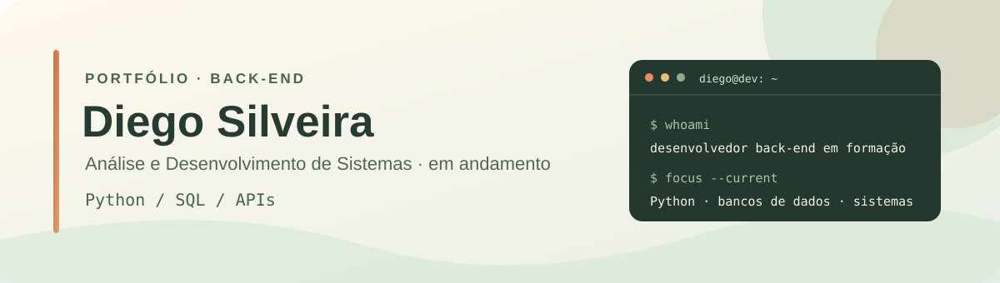

  <picture>
    <source media="(prefers-color-scheme: dark)" srcset="https://raw.githubusercontent.com/Kronosuchi17/kronosuchi17/main/assets/header-dark.svg">
    <source media="(prefers-color-scheme: light)" srcset="https://raw.githubusercontent.com/Kronosuchi17/kronosuchi17/main/assets/header-light.svg">
    
  </picture>

  <kbd>Python · intermediário</kbd>
  &nbsp; <kbd>Banco de dados · intermediário</kbd>
  &nbsp; <a href="https://github.com/Kronosuchi17">GitHub: Kronosuchi17</a>

## `$ whoami`

Sou **Diego Silveira**, graduando em **Análise e Desenvolvimento de Sistemas**. Estou direcionando minha carreira para **desenvolvimento back-end com Python e bancos de dados**.

Tenho conhecimento intermediário em Python e bancos de dados. Nos meus projetos web, também trabalho com APIs, persistência de dados e integração entre front-end e back-end.

## `$ projects --featured`

### EduTrack · Gestão escolar

Aplicação de gestão escolar estruturada em serviços separados para interface, back-end e banco de dados, com conteinerização e HTTPS.

**Stack do projeto:** React · TypeScript · Express · PostgreSQL · Docker  
**Código-fonte:** repositório privado

### Sistema Escolar · Presença e notas

Sistema para apoiar chamada, diário de classe, notas, boletins, comunicados e calendário.

**Stack do projeto:** React · TypeScript · Express · PostgreSQL  
**Código-fonte:** repositório privado

### Mural de Avisos · Comunicação escolar

Mural de comunicados por turma, com atualização em tempo real e notificações para responsáveis.

**Stack do projeto:** React · TypeScript · Express · PostgreSQL  
**Código-fonte:** repositório privado

## `$ toolkit --skills`

- **Python:** intermediário
- **Bancos de dados:** intermediário
- **Tecnologias presentes nos projetos:** TypeScript, React, Express, PostgreSQL e Docker

## `$ education --current`

🎓 **Análise e Desenvolvimento de Sistemas** — graduação em andamento

  
Cursos e certificados

- Linguagem de Programação em Python
- Administrando Banco de Dados
- Análise de Dados em Power BI
- Power BI
- Excel na Prática
- Excel Intermediário
- Estratégia de Negócio
- Hardware e Software
- Claude Code

## `$ next`

Criar projetos de back-end com Python e bancos de dados para demonstrar, na prática, como modelo dados, construo APIs e resolvo problemas com código.

---

<i>Construindo soluções úteis, aprendendo a cada projeto.</i>

